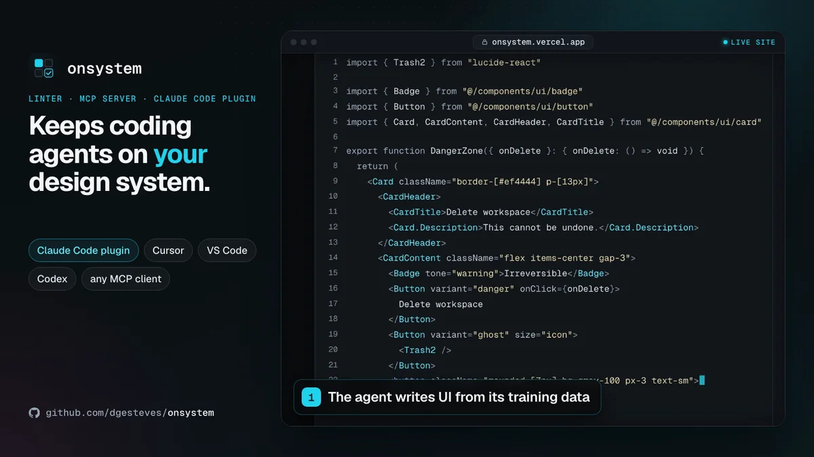

# onsystem

**Keeps coding agents on your design system:** catches palette colors, native elements and APIs your system lacks, at every edit and pull request, with the fix. Set it up once in your design-system package; every app in your monorepo gets it. Runs locally and works alongside [@shadcn/lint](https://github.com/shadcn-ui/lint).

Built for design-system and platform teams with a React design-system package; a shadcn/ui app is the zero-config demo. Formerly `@dgesteves/design-system-mcp` ([what changed](https://onsystem.vercel.app/docs/migrating)).

Using the GitHub Action? `uses: dgesteves/onsystem@v0` checks the lines a pull request changed: see [CI and baselines](https://onsystem.vercel.app/docs/ci).

[](https://github.com/dgesteves/onsystem/actions/workflows/ci.yml)
[](https://www.npmjs.com/package/onsystem)
[](https://registry.modelcontextprotocol.io/v0.1/servers/io.github.dgesteves%2Fonsystem/versions/latest)
[](https://cursor.directory/plugins/design-system-mcp)
[](LICENSE)

[](https://cursor.com/en/install-mcp?name=onsystem&config=eyJjb21tYW5kIjoibnB4IiwiYXJncyI6WyIteSIsIm9uc3lzdGVtIiwiLS1yb290IiwiJHt3b3Jrc3BhY2VGb2xkZXJ9Il19)
[](https://insiders.vscode.dev/redirect/mcp/install?name=onsystem&config=%7B%22command%22%3A%22npx%22%2C%22args%22%3A%5B%22-y%22%2C%22onsystem%22%2C%22--root%22%2C%22%24%7BworkspaceFolder%7D%22%5D%7D)
[](https://onsystem.vercel.app/docs/plugin)
[](https://github.com/marketplace/actions/onsystem-design-system-check)

**Also works with**
[](https://onsystem.vercel.app/docs/clients#codex-cli)
[](https://onsystem.vercel.app/docs/clients#gemini-cli)
[](https://onsystem.vercel.app/docs/clients#antigravity-cli-and-ide)
[](https://onsystem.vercel.app/docs/clients#grok-build)
[](https://onsystem.vercel.app/docs/clients#github-copilot-cli)
[](https://onsystem.vercel.app/docs/clients#claude-desktop)
[](https://onsystem.vercel.app/docs/clients#windsurf-devin-desktop)
[](https://onsystem.vercel.app/docs/clients#jetbrains-ides-ai-assistant-and-junie)
[](https://onsystem.vercel.app/docs/clients#zed)

**Website and docs:** [onsystem.vercel.app](https://onsystem.vercel.app), with a [playground](https://onsystem.vercel.app/playground) that checks your own code.

**Feedback wanted:** say where it breaks in the [launch feedback thread](https://github.com/dgesteves/onsystem/discussions/227), see what's next in the [roadmap](https://github.com/dgesteves/onsystem/blob/main/ROADMAP.md), or pick up a [good first issue](https://github.com/dgesteves/onsystem/issues?q=is%3Aissue%20state%3Aopen%20label%3A%22good%20first%20issue%22). If onsystem is useful to you, a star helps other people find it.

<!-- npm-readme:video -->

https://github.com/user-attachments/assets/900cc1fa-387c-4e76-a524-a818521dd1a0

<sub>On the <a href="https://onsystem.vercel.app">website</a>, an agent drafts a settings card, <code>check_ui</code> finds 11 problems with a fix each, and the agent applies them. Then a real Claude Code session with the plugin: Claude looks the components up before writing, and <code>check_ui</code> passes. Last, the benchmark.</sub>

<!-- npm-readme:image
<p align="center">
  <a href="https://onsystem.vercel.app"></a>
</p>

<sub>On the <a href="https://onsystem.vercel.app">website</a>, an agent drafts a settings card, <code>check_ui</code> finds 11 problems with a fix each, and the agent applies them. Then a real Claude Code session with the plugin: Claude looks the components up before writing, and <code>check_ui</code> passes. Last, the benchmark.</sub>
-->

## The problem

Coding agents write UI from their training data, not from your design system. Ask for a settings card and you get `bg-[#ef4444]`, `p-[13px]`, a native `<button>`, `variant="danger"` on a `Button` that only has `destructive`, and `<Card.Header>` where the system exports `CardHeader`. On the demo draft above, `tsc` reports 3 of the 11 problems, and review catches the rest when someone has the time. Describing the design system to the agent helps; what holds is checking what it actually wrote, at the edit and at the pull request.

## What it checks

onsystem reads your components, `cva` and `tv` variants, parts and tokens from source with the TypeScript compiler, and checks `.tsx` and `.jsx` against them. Every finding has a rule id, a location and the fix. Tokens come from your stylesheets, [DTCG 2025.10 files or a DESIGN.md](https://onsystem.vercel.app/docs/tokens), and `onsystem export` writes them out as either.

| Rule                             | Default | Catches                                                                         |
| -------------------------------- | ------- | ------------------------------------------------------------------------------- |
| `no-unknown-component`           | error   | Components and parts that don't exist (`<Card.Header>`, typos)                  |
| `no-unknown-prop`                | error   | Props a component doesn't take (`tone`, `isDisabled`)                           |
| `no-unknown-variant`             | error   | Values outside a variant (`variant="danger"`)                                   |
| `prefer-design-system-component` | error   | Native elements the design system has a component for (`<button>` → `<Button>`) |
| `no-hardcoded-color`             | error   | Hex, rgb, hsl, oklch and Tailwind palette colors (`bg-gray-100` → `bg-muted`)   |
| `icon-button-accessible-name`    | error   | Icon-only buttons without an accessible name                                    |
| `no-hardcoded-spacing`           | warn    | Arbitrary padding, margin and gap (`p-[13px]` → `p-3`)                          |
| `no-hardcoded-radius`            | warn    | Arbitrary radius (`rounded-[7px]` → `rounded-sm`)                               |

**How often it is wrong.** The [corpus](corpus) job runs `check` on 12 public repositories pinned by commit (Documenso, Dub, Cal.com, midday, Flowise and others: 24 runs, 14,539 distinct findings), without their dependencies installed (the two MUI apps get MUI). A seeded random sample of 80 of those findings, stratified by rule, was labelled from the code alone: blind labels by an AI reviewer (Claude Opus 5.5), not by a person. 57 are right, 14 debatable and 9 false positives: 11.2% (95% Wilson interval 6.0-20.0%), about the same when weighted by each rule's share of all findings (11.0%). Most come from `no-hardcoded-color` (7 of 65 sampled). Counting values a project's own design system already uses as debatable, 6 of 80 are false positives (7.5%, 3.5-15.4%). The [sample](corpus/fp-sample-20261016) has each label with its reason, the labeller's notes and the script behind these numbers. Shipped code rarely invents components, props or variants, and without dependencies `no-unknown-prop` skips components whose props do not resolve: those three rules have 56 findings in the corpus, 55 of them in Flowise, an MUI app, and 3 in the sample, all right but too few for a rate of their own. The corpus's older labels, made by an AI reviewer who could see the finding and so not blind, fail the job when one of their true positives stops being reported or a fixed false positive comes back. Code installed from a shadcn registry, such as the chatbot's `components/ai-elements`, has no labels yet ([Code from shadcn registries](https://onsystem.vercel.app/docs/configuration#code-from-shadcn-registries)). The [rules reference](https://onsystem.vercel.app/rules) shows each rule on an example and how to [suppress a finding](https://onsystem.vercel.app/rules#suppressing-findings).

## Quickstart

Run it from the app's folder or from the monorepo root, with Node.js 20.19 or later:

```sh
npx -y onsystem inspect   # what it found; --explain says why
npx -y onsystem check .   # the same check the agent and CI run
npx -y onsystem init      # write the config, and offer a baseline
```

At a [monorepo root](https://onsystem.vercel.app/docs/configuration#monorepo-roots), `inspect` lists every app and design-system package, and `check` checks each file by its own project's design system. In a [design-system package](https://onsystem.vercel.app/docs/design-system-packages), `init` sets it up for every app that depends on it, with no config in the apps: as a workspace package, or installed from npm. Installed apps read the components from the sources the package publishes, or from its type declarations (`.d.ts`) when it publishes only compiled `dist/`, and get every rule either way (`init` checks its `files` list). From a package that publishes compiled code and no type declarations, they get the token rules but no component, prop, variant or native-element checks.

In a new create-next-app, the template page's hardcoded colors already make the first `check .` fail; `init` offers to record them as a baseline, so only new findings fail. Folders installed from a shadcn registry, such as `components/ai-elements`, are someone else's code: [Code from shadcn registries](https://onsystem.vercel.app/docs/configuration#code-from-shadcn-registries) says how to check them or leave them out.

**Claude Code.** The plugin brings the hook, the MCP server and a skill:

```text
/plugin marketplace add dgesteves/onsystem
/plugin install onsystem@dgesteves
```

After each Write or Edit of a `.tsx` or `.jsx` file, the hook runs `onsystem check` on it. Errors go back to Claude as a blocking error with the fix, so Claude corrects the file before it moves on; warnings go as a note. It stays quiet in projects without a design system. Codex installs the same plugin, and the hook checks the files its `apply_patch` changes. [What it runs and touches](https://onsystem.vercel.app/docs/plugin).

**Cursor or VS Code.** [](https://cursor.com/en/install-mcp?name=onsystem&config=eyJjb21tYW5kIjoibnB4IiwiYXJncyI6WyIteSIsIm9uc3lzdGVtIiwiLS1yb290IiwiJHt3b3Jrc3BhY2VGb2xkZXJ9Il19) [](https://insiders.vscode.dev/redirect/mcp/install?name=onsystem&config=%7B%22command%22%3A%22npx%22%2C%22args%22%3A%5B%22-y%22%2C%22onsystem%22%2C%22--root%22%2C%22%24%7BworkspaceFolder%7D%22%5D%7D), or commit the [config](https://onsystem.vercel.app/docs/clients#cursor-and-vs-code). The agent gets the tools and runs `check_ui` on what it writes.

**Other agents.** `npx skills add dgesteves/onsystem` adds the skill to any agent with Agent Skills, and there are [plugins for Codex, GitHub Copilot CLI, VS Code and Cursor](https://onsystem.vercel.app/docs/clients#plugins-for-other-agents).

**Any MCP client.** Run `npx -y onsystem` as a stdio server. There are [configs for Claude Desktop, Codex CLI, GitHub Copilot CLI, Windsurf, JetBrains IDEs, Zed, Gemini CLI, Antigravity and Grok Build](https://onsystem.vercel.app/docs/clients#other-clients).

**CI.** Install it as a dev dependency, accept the findings the codebase already has once, and fail pull requests only on new ones:

```sh
npm install --save-dev onsystem
npx onsystem check . --update-baseline   # writes onsystem.baseline.json: commit it
```

```yaml
- run: npx onsystem check . --format github --require-design-system
```

Findings show up as annotations on the pull request, and `--require-design-system` fails the job when the design system is no longer found. [CI and baselines](https://onsystem.vercel.app/docs/ci) has the whole workflow.

**GitHub Action.** The [action](https://github.com/marketplace/actions/onsystem-design-system-check) runs the same check, honours the baseline and annotates only the lines a pull request changed. It goes after the checkout and the install, so it can read your design system:

```yaml
steps:
  - uses: actions/checkout@v7
  - uses: actions/setup-node@v7
    with:
      node-version: 24
      cache: npm
  - run: npm ci
  - uses: dgesteves/onsystem@v0
```

[Make it a required check on agent pull requests](https://onsystem.vercel.app/docs/required-check) has the whole workflow and its inputs.

**ESLint.** The same rules for ESLint 8.57, 9 and 10: add `onsystem.configs.recommended` from `onsystem/eslint` to `eslint.config.mjs` ([ESLint plugin](https://onsystem.vercel.app/docs/eslint), with @shadcn/lint).

## Works with @shadcn/lint

[@shadcn/lint](https://github.com/shadcn-ui/lint) checks the Tailwind classes written against a component and the theme (restyling, raw colors, arbitrary and unknown classes) as ESLint or Oxlint rules on Tailwind v4. onsystem checks that the components, props and variant values exist and flags native elements and unnamed icon buttons, on Tailwind v3 or v4. Its MCP server shows the agent your components and tokens before it writes, and in Claude Code its hook checks every edit. Run both. Benchmark v2 also scores every output with @shadcn/lint: see [the independent scorer's table](bench/v2/results/standard/results.md#independent-scorer-shadcnlint).

## Does it help?

[Benchmark v2](bench/v2) gave 6 models from 3 providers (Anthropic, OpenAI and Google) 20 single-file UI tasks in 5 open-source repositories, without onsystem, with its skill, MCP server or hook, and with all three: 1,200 runs, 240 per arm. Counted by onsystem 0.5.0's own check, design-system errors per run went from 0.85 without onsystem to 0.00 with all three, with no measurable change in the `tsc` pass rate (93% → 92%).

That count is onsystem's own, and the MCP server and the hook show the agent the same errors to fix. In tasks that ask for a green status label in a design system with no success token, agents with onsystem often used `chart-*` tokens, which it counts as clean. The blind labels by an AI reviewer, 12 files per arm, are too few to confirm the count either way, and every violation they found with the hook or all three is a palette color in Dub, whose tokens 0.5.0 did not read. The [benchmark page](https://onsystem.vercel.app/benchmark) has every table, and [bench/v2](bench/v2) the method, the per-run data and every generated file.

## Compatibility

What `package.json` declares and CI runs:

| With             | Supported                                                                                                                                                                                              |
| ---------------- | ------------------------------------------------------------------------------------------------------------------------------------------------------------------------------------------------------ |
| Node.js          | Node.js 20.19 or later (`engines`). CI runs the tests on Node.js 22, 24 and 26, and the built package on 20.19                                                                                         |
| Operating system | Linux, macOS and Windows: CI runs the tests and the pack test on each                                                                                                                                  |
| ESLint           | ESLint 8.57, 9 and 10, for the ESLint plugin only: `eslint` is an optional peer, and the CLI, the MCP server, the hook and the Action do not need it                                                   |
| TypeScript       | Your project's TypeScript is not used, and a JavaScript project needs none: onsystem reads `.tsx` and `.jsx` with its own TypeScript 6.0, a dependency, not a peer                                     |
| React            | Components written for React 18 (`forwardRef`) or React 19 (`ref` as a prop), read from source or type declarations. onsystem does not depend on React                                                 |
| Tailwind CSS     | v4 (`@theme`) and v3 (`tailwind.config`, read without running it). Without Tailwind, tokens come from CSS custom properties, DTCG files or a DESIGN.md                                                 |
| shadcn/ui        | Both bases, Radix (`asChild`) and Base UI (`render`), on Tailwind v3 or v4, with no config                                                                                                             |
| MCP clients      | Any client that starts a stdio server; CI connects on the 2025-11-25 and 2026-07-28 protocols. [Set up your agent](https://onsystem.vercel.app/docs/clients) has each client's config and support tier |

## Docs

On the [website](https://onsystem.vercel.app/docs), and as Markdown in [docs/](docs):

- [Quickstart](https://onsystem.vercel.app/docs), [Claude Code plugin](https://onsystem.vercel.app/docs/plugin), [CI and baselines](https://onsystem.vercel.app/docs/ci) and [Set up your agent](https://onsystem.vercel.app/docs/clients), with the config for each client
- [Configuration](https://onsystem.vercel.app/docs/configuration), [Rules](https://onsystem.vercel.app/rules), [MCP tools](https://onsystem.vercel.app/docs/tools) and [Troubleshooting](https://onsystem.vercel.app/docs/troubleshooting)
- [How it works](https://onsystem.vercel.app/docs/how-it-works), [FAQ](https://onsystem.vercel.app/docs/faq) and [Migrating from design-system-mcp](https://onsystem.vercel.app/docs/migrating)

[Contributing](CONTRIBUTING.md), [security](SECURITY.md) and the [changelog](CHANGELOG.md) are in the repository.

## License

[MIT](LICENSE) © Diogo Esteves
